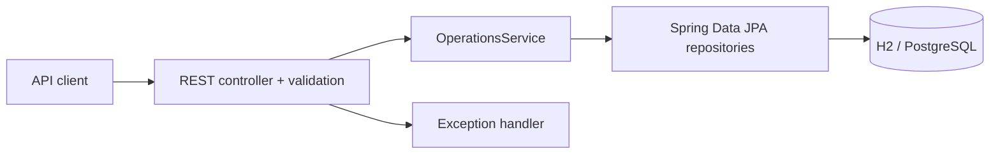

# OpsPulse Java — Infrastructure Operations API

   [](https://github.com/brovy23-GD/Opspulse-Java/actions/workflows/ci.yml)

**Java 21 and Spring Boot REST API for managing infrastructure services, manually reported health observations, incidents and operational summaries.**

Built by [Bobby Rovy](https://github.com/brovy23-GD) | [LinkedIn](https://www.linkedin.com/in/bobbyrovy)

## Overview

OpsPulse is an enterprise-style backend portfolio project demonstrating Spring Web, data persistence, validation, layered architecture, REST design and CI automation. It is unrelated to the athlete training features in [NextRep Java](https://github.com/brovy23-GD/Next-Rep-Java) and [Skill Builder Pro](https://github.com/brovy23-GD/Skill-Builder-Pro).

## Implemented features

- Create and list managed services with unique service keys and environment names.
- Record **manually submitted** health observations: `HEALTHY`, `DEGRADED`, `DOWN` or `UNKNOWN`.
- Retrieve recent health observations and current service health.
- Open incidents with severity `LOW`, `MEDIUM`, `HIGH` or `CRITICAL`.
- Advance incident status through `OPEN`, `INVESTIGATING` and `RESOLVED`.
- Summarize service health and active incident totals.
- Request DTO validation and structured HTTP 400, 404 and 409 errors.
- H2 in-memory database for development, optional PostgreSQL configuration, Docker Compose and GitHub Actions.

**Scope:** This is a locally runnable API prototype. It does not actively probe infrastructure, send alerts or include authentication. It is not a hosted production monitoring system.

## Technology stack

| Layer | Technology |
| --- | --- |
| Language and build | Java 21, Apache Maven |
| Framework | Spring Boot 3.5.16, Spring Web |
| Data layer | Spring Data JPA, Hibernate, H2, optional PostgreSQL |
| Validation and errors | Jakarta Bean Validation, centralized exception handler |
| Testing | JUnit Jupiter, Spring Boot Test, MockMvc |
| Operations | Spring Boot Actuator, Docker, Docker Compose, GitHub Actions |

## Architecture



See [Architecture](docs/architecture.md) for the domain model, persistence choices and limitations.

## Getting started

Prerequisites: **JDK 21** and **Maven 3.9.9+**. On Windows, the following selects Java 21 *only in the current PowerShell session*, preserving an existing Java 17 setup:

```powershell
$env:JAVA_HOME = 'C:\Program Files\Eclipse Adoptium\jdk-21.0.13.10002-hotspot'
$env:Path = "$env:JAVA_HOME\bin;$env:Path"
$mvn = 'C:\Users\brovy\tools\apache-maven-3.9.9\bin\mvn.cmd'
& $mvn -version
& $mvn clean verify
& $mvn spring-boot:run
```

Open the application health endpoint at [http://localhost:8080/actuator/health](http://localhost:8080/actuator/health). This reports the **OpsPulse process health**, not the health of managed services.

## Try the API (PowerShell)

```powershell
$base = 'http://localhost:8080/api/v1'
$svc = Invoke-RestMethod -Method Post -Uri "$base/services" -ContentType 'application/json' -Body '{"serviceKey":"payments-api","name":"Payments API","environment":"dev"}'
Invoke-RestMethod -Method Post -Uri "$base/services/$($svc.id)/observations" -ContentType 'application/json' -Body '{"health":"DEGRADED","note":"High latency"}'
$incidentBody = @{ serviceId=$svc.id; title="Slow payments"; severity="HIGH" } | ConvertTo-Json
$incident = Invoke-RestMethod -Method Post -Uri "$base/incidents" -ContentType 'application/json' -Body $incidentBody
Invoke-RestMethod -Method Patch -Uri "$base/incidents/$($incident.id)" -ContentType 'application/json' -Body '{"status":"RESOLVED"}'
Invoke-RestMethod "$base/dashboard"
```

## API endpoints

| Method | Path | Purpose |
| --- | --- | --- |
| `POST` | `/api/v1/services` | Register a service |
| `GET` | `/api/v1/services` | List services |
| `GET` | `/api/v1/services/{id}` | Service details |
| `POST` | `/api/v1/services/{id}/observations` | Record health |
| `GET` | `/api/v1/services/{id}/observations` | Recent observations |
| `POST` | `/api/v1/incidents` | Open incident |
| `GET` | `/api/v1/services/{id}/incidents` | Incident history |
| `PATCH` | `/api/v1/incidents/{id}` | Update incident status |
| `GET` | `/api/v1/dashboard` | Service and incident totals |
| `GET` | `/actuator/health` | OpsPulse application status |

## Tests and CI

Run `mvn clean verify` to compile, execute JUnit and MockMvc tests, and package the Spring Boot application. The GitHub Actions [Java CI workflow](.github/workflows/ci.yml) runs the same Maven verification command using Temurin 21.

**Verification:** Do not assume tests pass solely because a workflow is present. Check the GitHub Actions badge and workflow run results. The unit test covers incident transitions; MockMvc integration tests exercise REST service registration, observations, incident lifecycle, dashboard calculations, validation errors and duplicate keys.

## Docker + PostgreSQL

```bash
docker compose up --build -d
docker compose ps
docker compose down
```

The Compose configuration starts PostgreSQL and the Spring Boot API. The example password is for throwaway local testing only; use environment secrets and a unique password elsewhere. Schema update is intended only for development; use migrations in production.

## Project structure

```text
src/main/java/com/rovy/opspulse/
  api/                 REST endpoints and exception mapping
  domain/              JPA entities and enums
  dto/                 request validation and response records
  repository/          Spring Data repositories
  service/             transactional business logic
src/main/resources/    H2 and PostgreSQL profiles
src/test/java/         JUnit and MockMvc tests
.github/workflows/     Maven CI
assets/                Repository banner
docs/                  Architecture notes
Dockerfile             Multi-stage image build
compose.yml            PostgreSQL and API stack
```

## Current limitations and roadmap

- Health data is entered through APIs; there is no HTTP probing or scheduling.
- H2 data is in-memory and resets on application restart.
- No security authentication, authorization, audit logging, alerting, OpenAPI UI, tracing or cloud deployment.
- Future milestones: **Spring Security, Flyway, scheduled HTTP probes, Testcontainers, OpenAPI, pagination and production-oriented configuration**.

See [Contributing](CONTRIBUTING.md) and [Security](SECURITY.md). This repository is a learning and portfolio demonstration, not a claim of production deployment.
