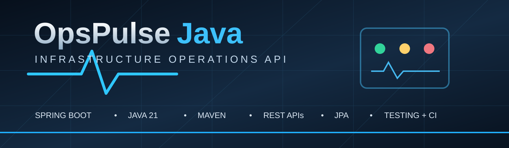
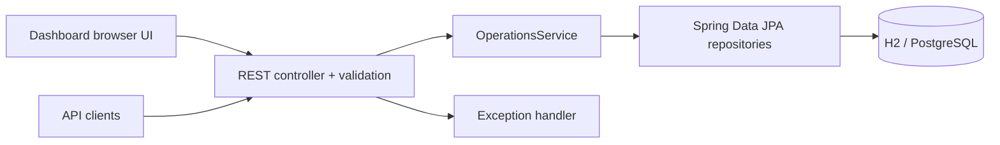

# OpsPulse Java — Infrastructure Operations Dashboard

   [](https://github.com/brovy23-GD/Opspulse-Java/actions/workflows/ci.yml)

**Java 21 and Spring Boot infrastructure operations dashboard with a responsive web UI and REST API for managing services, manually reported health observations, incidents and operational summaries.**

Built by [Bobby Rovy](https://github.com/brovy23-GD) | [LinkedIn](https://www.linkedin.com/in/bobbyrovy)

## Overview

OpsPulse is an enterprise-style full-stack Java portfolio project demonstrating a responsive browser dashboard served directly by Spring Boot, Spring Web, data persistence, validation, layered architecture, REST design and CI automation. It is unrelated to the athlete training features in [NextRep Java](https://github.com/brovy23-GD/Next-Rep-Java) and [Skill Builder Pro](https://github.com/brovy23-GD/Skill-Builder-Pro).

## Dashboard (new)

Run the Spring Boot application and open **[http://localhost:8080/](http://localhost:8080/)** to use the dashboard. It is served as static HTML, CSS and JavaScript by the existing Spring Boot application—there is no separate frontend server, npm build or external charting dependency.

The dashboard includes an opt-in **Load demo data** button for ten fictional infrastructure services and five incidents (three active, two resolved). The loader preserves existing records and is idempotent: repeated clicks skip services with reserved `demo-` keys rather than creating duplicates. All demo health observations are simulated, never measured. The button is enabled in the default H2 local configuration and disabled for the PostgreSQL profile.\n\nThe dashboard includes live API-backed summary cards, a donut chart of manually reported service health, searchable and filterable service inventory, service registration, manual health observation entry, incident creation and incident state transitions. It also provides responsive mobile layouts, loading/empty states, form validation and API error feedback.

**Important:** This is an *interactive local UI*, not a publicly hosted service or automatic infrastructure monitoring platform. Its counts derive from reported health data and incidents saved by the API. The interface does not fetch real monitoring telemetry or provide historical uptime charts. The UI and API are intentionally unauthenticated in this portfolio prototype; do not expose them on the public Internet.

## Automatic HTTPS monitoring (opt-in)

OpsPulse now supports **actual scheduled HTTP GET checks** for trusted, operator-configured HTTPS URLs. It records the HTTP status code, measured request duration, check timestamp, and success or failure in a dedicated monitoring-history table, and adds an observation to the corresponding managed service. Checks are **not simulated** when enabled; the default demo data remains fictional.

Monitoring is **disabled by default**. The sample configuration includes `https://example.com/` solely as an example of a public HTTPS endpoint; it is *not* one of your own systems. To enable it for a local run, open PowerShell and set the property **before** starting the application:

```powershell
$env:OPSPULSE_MONITOR_ENABLED = 'true'
# Start your existing mvn spring-boot:run command in this same PowerShell session.
```

The first check starts approximately **60 seconds after startup**, then repeats roughly every 60 seconds (plus check duration). Open `http://localhost:8080/#monitoring` to see the most recent 30 results. A newly monitored service is created on the first completed check; check history is saved in the database alongside other OpsPulse records. To disable again, stop the application and set `$env:OPSPULSE_MONITOR_ENABLED = 'false'` before restarting. The H2 database still resets on restart.

To monitor additional systems, edit **trusted configuration** under `opspulse.monitor.targets` in `src/main/resources/application.yml` (or provide an equivalent configuration source). Each target has a unique `service-key`, display `name`, and HTTPS `url`. Standard HTTPS on port 443 is required; user credentials, URL query strings, fragments, localhost, IP literals, and custom ports are refused. The HTTP client does not follow redirects and uses short timeouts. **The endpoint list is not editable through the browser or API.** Only add endpoints you own or are authorized to check, and do not publicly expose this unauthenticated learning application.

**Scope:** A 2xx HTTP response is considered healthy; other responses and connection failures are marked down. This is basic endpoint availability monitoring, **not** complete distributed systems monitoring or a production-ready alerting system. There is no authentication, domain-to-address pinning, automatic incident creation, outage threshold, or notification system yet. Configure trusted DNS names only in a trusted local environment; DNS names can resolve to private infrastructure, so do not give untrusted users control of the configuration.

## Implemented features

- Create and list managed services with unique service keys and environment names.
- Record **manually submitted** health observations: `HEALTHY`, `DEGRADED`, `DOWN` or `UNKNOWN`.
- Retrieve recent health observations and current service health.
- Open incidents with severity `LOW`, `MEDIUM`, `HIGH` or `CRITICAL`.
- Advance incident status through `OPEN`, `INVESTIGATING` and `RESOLVED`.
- Summarize service health and active incident totals.
- Request DTO validation and structured HTTP 400, 404 and 409 errors.
- Opt-in scheduled HTTPS endpoint checks and persisted response times, HTTP status codes, observation and check histories.\n- H2 in-memory database for development, optional PostgreSQL configuration, Docker Compose and GitHub Actions.

**Scope:** This is a locally runnable API prototype. It does not actively probe infrastructure, send alerts or include authentication. It is not a hosted production monitoring system.

## Technology stack

| Layer | Technology |
| --- | --- |
| Language and build | Java 21, Apache Maven |
| Framework | Spring Boot 3.5.16, Spring Web |
| Frontend | Vanilla HTML5, CSS3, JavaScript, responsive design, accessible native controls |
| Data layer | Spring Data JPA, Hibernate, H2, optional PostgreSQL |
| Validation and errors | Jakarta Bean Validation, centralized exception handler |
| Testing | JUnit Jupiter, Spring Boot Test, MockMvc |
| Operations | Spring Boot Actuator, Docker, Docker Compose, GitHub Actions |

## Architecture



See [Architecture](docs/architecture.md) for the domain model, persistence choices and limitations.

## Getting started

Prerequisites: **JDK 21** and **Maven 3.9.9+**. On Windows, the following selects Java 21 *only in the current PowerShell session*, preserving an existing Java 17 setup:

```powershell
$env:JAVA_HOME = 'C:\Program Files\Eclipse Adoptium\jdk-21.0.13.10002-hotspot'
$env:Path = "$env:JAVA_HOME\bin;$env:Path"
$mvn = 'C:\Users\brovy\tools\apache-maven-3.9.9\bin\mvn.cmd'
& $mvn -version
& $mvn clean verify
& $mvn spring-boot:run
```

Open **http://localhost:8080/** for the dashboard. The API is served from the same origin. Open the application health endpoint at [http://localhost:8080/actuator/health](http://localhost:8080/actuator/health). This reports the **OpsPulse process health**, not the health of managed services.

## Try the API (PowerShell)

```powershell
$base = 'http://localhost:8080/api/v1'
$svc = Invoke-RestMethod -Method Post -Uri "$base/services" -ContentType 'application/json' -Body '{"serviceKey":"payments-api","name":"Payments API","environment":"dev"}'
Invoke-RestMethod -Method Post -Uri "$base/services/$($svc.id)/observations" -ContentType 'application/json' -Body '{"health":"DEGRADED","note":"High latency"}'
$incidentBody = @{ serviceId=$svc.id; title="Slow payments"; severity="HIGH" } | ConvertTo-Json
$incident = Invoke-RestMethod -Method Post -Uri "$base/incidents" -ContentType 'application/json' -Body $incidentBody
Invoke-RestMethod -Method Patch -Uri "$base/incidents/$($incident.id)" -ContentType 'application/json' -Body '{"status":"RESOLVED"}'
Invoke-RestMethod "$base/dashboard"
```

## API endpoints

| Method | Path | Purpose |
| --- | --- | --- |
| `POST` | `/api/v1/services` | Register a service |
| `GET` | `/api/v1/services` | List services |
| `GET` | `/api/v1/services/{id}` | Service details |
| `POST` | `/api/v1/services/{id}/observations` | Record health |
| `GET` | `/api/v1/services/{id}/observations` | Recent observations |
| `POST` | `/api/v1/incidents` | Open incident |
| `GET` | `/api/v1/services/{id}/incidents` | Incident history |
| `PATCH` | `/api/v1/incidents/{id}` | Update incident status |
| `GET` | `/api/v1/dashboard` | Service and incident totals |\n| `GET` | `/api/v1/monitor` | Monitoring enabled status, configured target count, recent real check history |\n| `POST` | `/api/v1/demo/load` | Seed fictional data (enabled only with `opspulse.demo.enabled=true`) |
| `GET` | `/actuator/health` | OpsPulse application status |

## Tests and CI

Run `mvn clean verify` to compile, execute JUnit and MockMvc tests, and package the Spring Boot application. The GitHub Actions [Java CI workflow](.github/workflows/ci.yml) runs the same Maven verification command using Temurin 21, along with Node.js JavaScript syntax and refresh-regression checks. Demo seed creation, idempotency, preserved existing records and incident status counts are covered by MockMvc tests. Spring MockMvc integration tests verify that the dashboard page, CSS and JavaScript are served on the same origin as the API. The workflow does not run an automated browser or visual regression test.

**Verification:** Do not assume tests pass solely because a workflow is present. Check the GitHub Actions badge and workflow run results. The unit test covers incident transitions; MockMvc integration tests exercise REST service registration, observations, incident lifecycle, dashboard calculations, validation errors and duplicate keys.

## Docker + PostgreSQL

```bash
docker compose up --build -d
docker compose ps
docker compose down
```

The Compose configuration starts PostgreSQL and the Spring Boot API. The example password is for throwaway local testing only; use environment secrets and a unique password elsewhere. Schema update is intended only for development; use migrations in production.

## Project structure

```text
src/main/java/com/rovy/opspulse/
  api/                 REST endpoints and exception mapping
  domain/              JPA entities and enums
  dto/                 request validation and response records
  repository/          Spring Data repositories
  service/             transactional business logic
src/main/resources/    H2 and PostgreSQL profiles
src/test/java/         JUnit and MockMvc tests
.github/workflows/     Maven CI
src/main/resources/static/ Dashboard HTML and CSS/JS
assets/                Repository banner
docs/                  Architecture notes
Dockerfile             Multi-stage image build
compose.yml            PostgreSQL and API stack
```

## Current limitations and roadmap

- By default health is manually entered or simulated. Optional scheduled HTTPS probes operate only when explicitly enabled and configured.
- H2 data is in-memory and resets on application restart. Demo services are clearly identified by `demo-` keys and remain in the same in-memory database.\n- The demo-load endpoint is a write operation intended only for trusted local use. It is disabled under the PostgreSQL profile; set `opspulse.demo.enabled=false` for other environments. Do not expose this unauthenticated prototype publicly.
- No security authentication, authorization, audit logging, alerting, OpenAPI UI, tracing or cloud deployment.
- Browser dashboard shows manually submitted and optional scheduled HTTPS observations; there is no alert push, automatic incident workflow, or real-time background streaming.
- Frontend is covered by static-serving integration tests and syntax checking; automated end-to-end browser tests remain a future milestone.
- Future milestones: **Spring Security, Flyway, secure monitoring target management, DNS/IP network restrictions, failure thresholds, automatic incidents, Testcontainers, OpenAPI, pagination and production-oriented configuration**.

See [Contributing](CONTRIBUTING.md) and [Security](SECURITY.md). This repository is a learning and portfolio demonstration, not a claim of production deployment.
