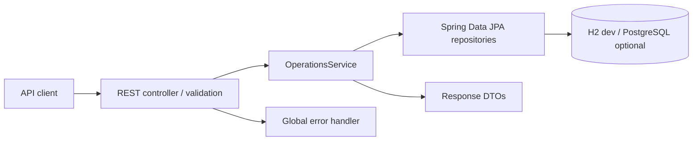

# Architecture

## Design

- `ManagedService` is an inventory record with a human-readable service key and current reported health.
- `HealthObservation` stores a manual observation and updates the service's current health in one transaction.
- `Incident` tracks a separate operational problem and its state transitions. Resolved incidents cannot be reopened in this prototype.
- DTO records keep persistence entities off the wire and apply Bean Validation at the controller boundary.
- Spring Data repositories provide persistence through H2 by default; the PostgreSQL profile is optional.
- `GET /actuator/health` checks **this API process**, not infrastructure inventory health.

## Scope and planned improvements

Current service health is manually reported by API calls. No scheduled polling, alert dispatch, authentication, metrics scraping, API documentation UI, schema migrations or production deployment is implemented. Future milestones: Flyway migrations, actual HTTP probes, Spring Security, paginated filtering, Testcontainers integration, OpenAPI, and service-level metrics.
