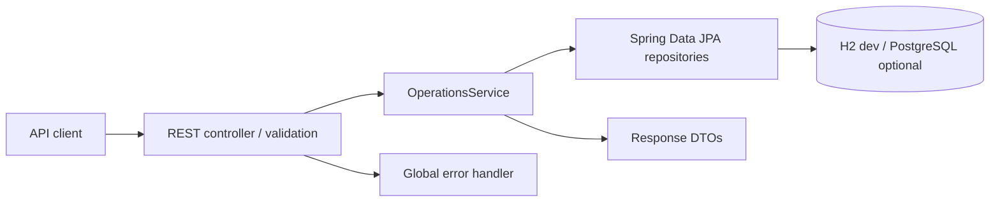

# Architecture

## Design

- `ManagedService` is an inventory record with a human-readable service key and current reported health.
- `HealthObservation` stores a manual observation and updates the service's current health in one transaction.
- `Incident` tracks a separate operational problem and its state transitions. Resolved incidents cannot be reopened in this prototype.
- DTO records keep persistence entities off the wire and apply Bean Validation at the controller boundary.
- Spring Data repositories provide persistence through H2 by default; the PostgreSQL profile is optional.
- `GET /actuator/health` checks **this API process**, not infrastructure inventory health.

## Scope and planned improvements

Current service health is manually reported by API calls. No scheduled polling, alert dispatch, authentication, metrics scraping, API documentation UI, schema migrations or production deployment is implemented. Future milestones: Flyway migrations, actual HTTP probes, Spring Security, paginated filtering, Testcontainers integration, OpenAPI, and service-level metrics.

## Browser dashboard

Spring Boot serves `src/main/resources/static/index.html` at `/` and static assets under `/dashboard/`. A dependency-free JavaScript client calls the existing `/api/v1` endpoints on the same origin. The dashboard has four summary cards, a health distribution graphic, a filterable service table, and incident management. Health is updated only by submitting an observation; it is not calculated from network probes.

The incident list is collected from `GET /api/v1/services/{id}/incidents` for each registered service because the original API has no global incident-list endpoint. This is adequate for a small demo but should become one paginated endpoint for larger inventories. Counts are supplied by `GET /api/v1/dashboard`.

User-supplied text is inserted via DOM `textContent`, not `innerHTML`. Native forms handle validation and announce errors in a live region. The frontend has no secrets and uses no third-party browser libraries.

## Frontend verification

`DashboardPageTest` uses Spring MockMvc to confirm the root page, static JavaScript/CSS, and dashboard JSON endpoint are served together. GitHub Actions validates JavaScript syntax with Node.js 22 and runs Maven/JUnit tests. A full browser-driven E2E suite is not implemented yet.
